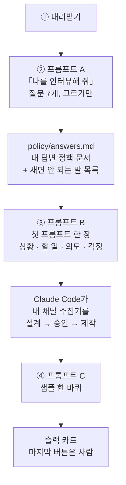
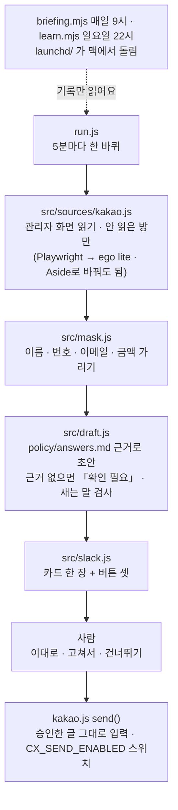

# 셀피쉬클럽 CX 스타터 키트

> **카카오 채널 문의를 AI가 초안 쓰고, 사람은 마지막 버튼만 누르는 CX 워크플로우** — 설계도 · 규칙 · 시작 프롬프트
>
> 셀피쉬클럽(회원 1.2만 명 커뮤니티)이 실제로 돌리는 워크플로우를, 여러분 채널에 맞게 다시 만들 수 있게 묶었어요.
> 2026-11-07 AX 살롱 VOL.01 발표에서 **v1**을 공개했고, 11/9에 **v2(실제 코드)**까지 올렸어요.
> 투표는 2등이었어요. 그래도 응원해 주신 마음에 감사해서 전부 열어요. 코드는 저희 환경 기준이라 안 돌아가는 자리가 있으면 각자 버전에 맞춰 고쳐 쓰세요. Claude Code에 붙여 넣으면 금방이에요.

---

## 받는 법 — 주소 주고 「내려받아 줘」 하면 끝

Claude Code(또는 Codex)를 켜고 이렇게 말해요.

> **https://github.com/selfishclub/selfish-ax-cx-starter-kit 이거 내려받아 줘**

그게 다예요. 내려받아지면 이어서 **「START_HERE.md 읽고 프롬프트 A부터 시작하자」** 라고 하면 돼요.
코드까지 바로 돌려 보려면 **「pipeline/README.md 읽고 샘플 한 바퀴 돌리자」**.

<details>
<summary>직접 받고 싶으면 (터미널)</summary>

```bash
git clone https://github.com/selfishclub/selfish-ax-cx-starter-kit.git
cd selfish-ax-cx-starter-kit
claude
```
</details>

---

## v1 구조도 — 이렇게 써요



> **뒤에서 도와요** — `.claude/skills/` 4개(인터뷰 · 표준 답 뽑기 · 화면 맞추기 · 주 1회 학습)는 ②와 Claude Code가 만들 때 알아서 쓰여요. 막히면 `docs/` 01~05(왜 이렇게 · 구조 · 실패 · 다른 채널 · 넘지 않는 선)를 읽어요.

| 단계 | 하는 일 | 걸리는 시간 | 어디 |
|---|---|---|---|
| ① 내려받기 | 위 한 줄 | 1분 | — |
| ② 인터뷰 | **프롬프트 A** 붙여 넣기 → 질문 7개에 고르기만 하면 `policy/answers.md`(내 답변 정책 문서) · `policy/leak-words.json`(새면 안 되는 말)이 생겨요 | 20~30분 | [`START_HERE.md`](START_HERE.md) |
| ③ 첫 프롬프트 | **프롬프트 B**의 괄호를 내 상황으로 바꿔 넣으면, Claude Code가 내 채널에 맞는 수집기를 어떤 순서 · 어떤 파일로 만들지 설명하고 승인받은 뒤 만들어요 | 30분~ | [`START_HERE.md`](START_HERE.md) |
| ④ 샘플 한 바퀴 | **프롬프트 C** — 가짜 문의 1건으로 초안 → 카드까지 돌려 봐요 | 10분 | [`START_HERE.md`](START_HERE.md) |

> **v1만 활용하셔도 충분히 도움이 되실 거예요. 저희도 코드보다 정책 문서부터 만들었어요.**
> 정책 문서가 있으면 어떤 도구로 짜든 AI가 덜 헤매요. 「걱정」 칸을 빼먹으면 AI가 알아서 넘겨짚어요.

---

## v2 구조도 — 코드가 이렇게 돌아요

`pipeline/` 안의 파일이 그대로 아홉 칸이에요. 바꿔 끼울 곳은 둘(읽기 · 보내기)뿐이에요.



| 받으면 | 명령 | 걸리는 시간 |
|---|---|---|
| 정책 → 초안 한 바퀴 (슬랙 · 카카오 없이) | `cd pipeline && npm install && npm run check` | 5분 |
| 가짜 문의 → 슬랙 카드까지 | `.env.local`에 슬랙 값 넣고 `npm run cx:sample` | 10분 |
| 내 카카오 채널 붙이기 | `npm run login` → `npm run cx` | 10분 |

자세한 건 [`pipeline/README.md`](pipeline/README.md). 셀피쉬클럽 운영 코드에서 **걷어낸 것**(정책 원문 · 내부 도구 목록 · 채널 ID · 운영자 이름 · 마이페이지 챗봇 조각)도 거기 적어 뒀어요.

---

## 셀피쉬클럽 · 젬마

| | 링크 | 뭐가 있나 |
|---|---|---|
| 셀피쉬클럽 | **https://www.selfishclub.xyz/** | 프로그램 · 이기적 공유회 안내. **11/12(목) 「Aside로 워크플로우 냅다 만드는 실습 이기적 공유회」** 가 여기 올라와요 |
| AX 실전 실무 단톡방 | **https://open.kakao.com/o/goFVoDqf** | 이 키트 써 보다 막히면 여기서 물어보세요. AX 실전 · 실무 이야기 하는 셀피쉬클럽 오픈채팅 |
| 인스타그램 | **https://www.instagram.com/zemma.selfishclub/** | 젬마 · 셀피쉬클럽 소식 |
| 젬마 교육 | **https://ax-zemma.com/** | 기업 · 팀 대상 AX 교육 |

---

## 특징 · 이런 분께 · 받는 것 · 하지 않는 것

| | |
|---|---|
| **특징** | 코드가 아니라 **정책 문서가 먼저**예요. 「무엇을 보고 답하고, 무슨 말을 하면 안 되고, 언제 사람에게 넘기는지」를 인터뷰로 먼저 정하고, 그다음에 수집기를 짜게 해요. AI는 근거 없으면 지어내지 않고 「확인 필요」로 넘기고, 이름 · 번호는 AI가 보기 전에 가리고, 발송은 사람이 버튼을 눌러야만 나가요. |
| **이런 분께** | 혼자 · 작은 팀으로 커뮤니티나 가게를 운영하면서 **같은 문의에 매일 답하는 분** / AI는 쓰는데 **일에 붙이긴 막막한 분** / AI가 사고 칠까 봐 **맡기기 겁나는 분** / 개발은 몰라도 Claude Code로 뭔가 만들어 보고 싶은 분 |
| **필요한 것** | Claude Code(또는 Codex) · 문의가 들어오는 채널 하나(카카오 채널 · 채널톡 · 인스타 DM · 이메일 …) · 카드를 받을 메신저 하나(슬랙 · 디스코드 · 텔레그램) · 이미 보낸 답 몇 개 |
| **받는 것** | ① 우리가 어떻게 만들었는지 **설계도**(`docs/`) ② 뭘 절대 AI에 안 맡겼는지 **규칙**(`policy/`, `docs/05`) ③ Claude Code에 붙여 넣는 **시작 프롬프트 3개**(`START_HERE.md`) ④ 나를 인터뷰해서 정책 문서를 써 주는 **스킬 4개**(`.claude/skills/`) ⑤ 우리가 겪은 **실패 목록**(`docs/03`) ⑥ 셀피쉬클럽이 실제로 돌리는 **코드 그대로**(`pipeline/`) |
| **하지 않는 것** | 키트는 **발송 버튼을 대신 누르지 않아요.** 환불 · 결제 · 개인정보 문의는 사람에게 넘기게 돼 있어요. 비밀번호 · 키 값은 채팅에 붙여 넣지 말고 `.env.local`에 직접 넣어요. 코드(`pipeline/`)는 읽기 전용 · 발송 꺼짐으로 시작해요. |

---

## v1 / v2

| | **v1 — 설계도와 규칙** | **v2 — 실제 코드 (11/9 공개)** |
|---|---|---|
| 무엇 | 설계도 · 규칙 · 시작 프롬프트 · 인터뷰 스킬 · 실패 목록 | 셀피쉬클럽이 **실제로 돌리는 코드**를 개인정보 · 비밀값 걷어내고 그대로 |
| 받으면 | 내 답변 정책 문서가 생기고, 내 채널에 맞는 수집기를 Claude Code가 짜게 할 수 있어요 | `--sample`로 카카오 없이 가짜 문의 1건 → 초안 → 슬랙 카드까지 10분 안에 |
| 들어 있는 것 | `README` `START_HERE` `docs/` `policy/` `.claude/skills/` `examples/` | `pipeline/` — 카카오 읽기 → 가림 → 맥락 요약 → 초안 → 슬랙 카드 → 발송 · 아침 브리핑 · 일요일 학습 · 맥 자동 시작 · 대시보드 |
| 어디 | 이 저장소 | [`pipeline/`](pipeline/) · [`pipeline/README.md`](pipeline/README.md) |

---

## 폴더 안내

| 폴더 · 파일 | 무엇이 있나 |
|---|---|
| [`START_HERE.md`](START_HERE.md) | 붙여 넣을 프롬프트 A(인터뷰) · B(첫 프롬프트 한 장) · C(설계 승인 → 샘플 한 바퀴) |
| [`docs/01_왜_이렇게_만들었나.md`](docs/01_왜_이렇게_만들었나.md) | 카카오 API 없음 → 관리자 화면 읽기 · 적정 기술 기준 3 · 쓴 도구와 돈 |
| [`docs/02_구조_한_장.md`](docs/02_구조_한_장.md) | 모으기 → 가리기 → 맥락 읽기 → 판별 → 초안 → 카드 → 발송 → 브리핑 → 학습 |
| [`docs/03_우리가_겪은_실패.md`](docs/03_우리가_겪은_실패.md) | 로그인 세션 · 선택자 0자 · 방 단위 중복 · 두뇌 멈춘 걸 나흘 뒤에 앎 … |
| [`docs/04_다른_채널_다른_도구.md`](docs/04_다른_채널_다른_도구.md) | 이메일 · 채널톡 · 인스타 DM · 톡톡 / 텔레그램 · 디스코드 / Aside · ego lite |
| [`docs/05_넘지_않는_선.md`](docs/05_넘지_않는_선.md) | 발송 · 배포 · 돈 · 개인정보 — 말로 「하지 마」가 아니라 버튼 없으면 안 나가게 |
| [`.claude/skills/`](.claude/skills/) | `cx-interview`(나를 인터뷰) · `cx-policy-from-history`(보낸 답에서 표준 답 뽑기) · `cx-sync`(화면 바뀌면 정책 맞추기) · `cx-weekly-learn`(주 1회 수정안 PR) |
| [`policy/`](policy/) | `answers.template.md`(정책 문서 틀) · `answers.sample.md`(가상 커뮤니티 샘플 — v2 시험용) · `leak-words.example.json`(새면 안 되는 말) |
| [`examples/`](examples/) | 셀피쉬클럽 정책 발췌 · 슬랙 카드 구성 · 자영업자 사례 「리뷰 원터치」 |
| [`pipeline/`](pipeline/) | **v2 실제 코드** — `run.js` · `src/` · `tools/` · `briefing.mjs` · `learn.mjs` · `launchd/` · `filters.json`. 받으면 `npm run check` |
| [`.env.example`](.env.example) | 값 없이 이름만. 실제 값은 `.env.local`에 |

---

## 원칙 세 개 (이것만 지키면 돼요)

1. **근거 없으면 지어내지 않아요.** 답의 유일한 출처는 `policy/answers.md`. 없으면 초안을 쓰지 않고 「확인 필요」로 사람에게.
2. **AI가 보기 전에 가려요.** 이름 · 전화번호 · 이메일 · 금액은 AI에 보내기 전에 가리고, 회원 DB는 아예 열지 않아요.
3. **마지막 버튼은 사람.** 이대로 보내기 · 고쳐서 보내기 · 건너뛰기. 전량 자동 발송이 아니에요.

---

## 만든 곳 · 출처 · 이용 조건

- **만든 곳** — 셀피쉬클럽. 운영 다섯 가지(기획 · 상세페이지 / 신청 · 결제 · 어드민 / 홍보 링크 · CRM / 문의 응대 / 개선)를 전부 AI 워크플로우로 넘기면서 만든 것 중 **문의 응대** 조각이에요. 우리가 실제로 보낸 답 121개로 정책 문서를 만들고, 수집기는 카카오 채널 관리자 화면을 5분마다 읽어요.
- **출처** — AX 살롱 VOL.01 「AI가 그래서 뭘 해결했는데?」(2026-11-07) 젬마 발표.
- **이용 조건** — [`LICENSE`](LICENSE). 개인 학습용 또는 조직 내 사용만 허용해요. 그 밖의 용도(판매 · 유료 강의 · 컨설팅 · 교육 자료 · 재배포)는 허용하지 않아요. 소개할 땐 출처 한 줄: `셀피쉬클럽 CX 스타터 키트에서 시작했어요`.
